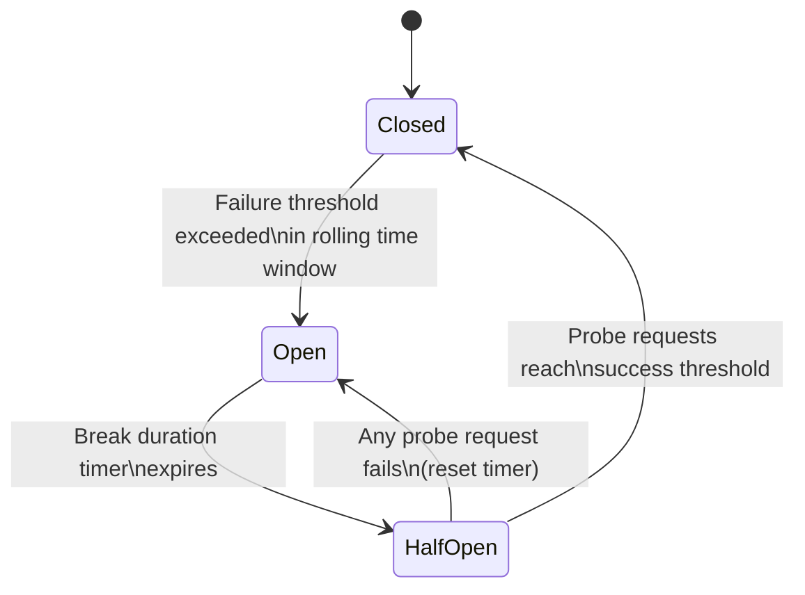

# Circuit Breaker, Retry, Bulkhead & OpenTelemetry

One idea: in distributed systems, **transient faults require bounded retries with backoff and jitter**, **sustained outages require fast-failing Circuit Breakers and Bulkheads** to stop cascading exhaustion, **user-facing paths require explicit Fallbacks**, and **every resilience boundary must emit correlated OpenTelemetry Traces, Metrics, and Logs** so operators can see what degraded and why. Sources and their claims: [references/sources.md](references/sources.md).

## Vocabulary (Azure Architecture Center, AWS Builders' Library & OpenTelemetry)

| Term | Meaning | Test sentence |
|---|---|---|
| Timeout | maximum duration a caller waits for connection establishment and response before aborting and releasing resources | "every remote call must bound both connect and request timeouts" |
| Capped Exponential Backoff with Jitter | waiting $t = \min(\text{cap}, \text{base} \cdot 2^{\text{attempt}})$ plus randomness (*Full Jitter* or *Equal Jitter*) between transient retries | "spreads retry bursts so recovering dependencies aren't hit by thundering herds" |
| Circuit Breaker | proxy state machine (**Closed** $\to$ **Open** $\to$ **Half-Open**) that fast-fails calls to a failing dependency instead of waiting for timeouts | "stops retry storms and gives an overloaded dependency breathing room to recover" |
| Bulkhead | partitioning caller pools (threads, connections, semaphores) or service instances into isolated cells so one failing dependency cannot exhaust shared resources | "a slow payments API cannot starve the catalog connection pool" |
| Fallback | graceful degradation path when retries exhaust or a circuit is Open (cached/stale value, default payload, queued deferral, or explicit error) | "returns degraded capability instead of crashing the whole request" |
| OTel Signals & Context Propagation | **Traces** (nested Spans via W3C `traceparent`), **Metrics** (Counters, Gauges, Histograms), and **Logs** correlated by `trace_id` and `span_id` | "every retry attempt, breaker trip, and bulkhead rejection is visible across services" |

## Circuit Breaker State Machine

1. **Closed:** Requests pass through; a time-windowed failure counter (or failure-rate threshold over a minimum request volume) trips the breaker to **Open** when exceeded.
2. **Open:** Requests fail immediately without touching the downstream dependency (or execute a **Fallback**), protecting caller threads/connections and letting the dependency recover.
3. **Half-Open:** After the break duration expires, only a bounded number of probe requests are admitted. Consecutive successes reset the breaker to **Closed**; any failure trips it straight back to **Open**.

## Core resilience and telemetry rules

1. **Compose resilience policies in the right nesting order (outer to inner):**
   - **Fallback** (outermost): catches terminal `BrokenCircuitException` or exhausted retries and serves degraded/default data.
   - **Total Operation Timeout / Retry** (with capped exponential backoff + jitter): retries **only** idempotent operations (`idempotency-fix`) and **only** transient faults (e.g. `429`, `503`, timeouts — never `400`/`401`/`403`/`404`), and **aborts immediately** if the inner Circuit Breaker reports **Open**.
   - **Circuit Breaker**: tracks failures across attempts; trips fast when the dependency is unhealthy.
   - **Per-Attempt Timeout & Bulkhead** (innermost): caps each individual network attempt and bounds concurrent in-flight calls/connections per dependency.
2. **Retry at a single layer in the call stack (avoid $k^n$ retry amplification):** If a 4-hop service chain retries 3 times at every hop, a single slow database query multiplies into $3^4 = 81$ (or $4^4 = 256$ total attempts) requests, turning minor latency into a total outage. Retry only at the boundary with full context (or use token-bucket retry budgets) and let inner hops fail fast.
3. **Partition Circuit Breakers and Bulkheads by failure domain:** Never share one Circuit Breaker or connection pool across independent shards, tenants, or unrelated downstream APIs — a single broken shard must not trip the circuit for healthy shards.
4. **Prevent long timeouts from defeating the Circuit Breaker:** If an external call timeout (e.g. 60s) exceeds the caller's concurrency budget, threads pile up before the failure counter can even trip. Set tight per-attempt timeouts based on downstream p99.9 latency plus reasonable padding, and pair with a Bulkhead semaphore.
5. **Instrument all three OpenTelemetry signals across every resilience event:**
   - **Traces:** Propagate W3C `traceparent` across hops (`SpanKind.CLIENT` on outbound calls). Record retry attempts and circuit state transitions as **Span Events** (with timestamps and attempt numbers); set `SpanStatus = Error` only when the operation ultimately fails (or record `fallback.used = true` as a span attribute).
   - **Metrics:** Emit low-cardinality metrics: `resilience.circuit_breaker.state` (gauge/up-down), `resilience.retry.attempts` (counter), `resilience.bulkhead.rejected` (counter), and `http.client.request.duration` (histogram). Never put unbounded IDs (`user_id`, `request_id`) in metric attributes.
   - **Logs:** Emit structured JSON logs carrying active `trace_id` and `span_id`. Log intermediate retryable faults at `INFO`/`WARN` and log only the exhausted terminal failure at `ERROR` so transient blips do not page operators unnecessarily.

## Building order

1. **Classify dependencies and failure modes:** For each downstream HTTP/RPC/DB dependency, define idempotency safety, transient vs. non-transient errors, p99.9 timeout, and acceptable fallback behavior.
2. **Add Bulkhead + Per-Attempt Timeout first:** Bound concurrency and wait time using battle-tested libraries (e.g., Polly in .NET, Resilience4j in Java, opossum/cockatiel in TS, or service-mesh sidecar limits) before adding retries.
3. **Add Capped Exponential Backoff + Jitter + Circuit Breaker:** Wire retry budgets/limits on idempotent calls and ensure Circuit Breaker Open short-circuits retries.
4. **Wire OpenTelemetry SDK & Collector:** Configure `TracerProvider`, `MeterProvider`, and correlated structured logging, exporting via OTLP to an OpenTelemetry Collector.

## Testing strategy

| Component | Test | Proves |
|---|---|---|
| Retry + Jitter | fault-injection unit/integration test | transient failures (`503`/`429`) succeed on retry within cap; `400` fails immediately with 0 retries; delays include jitter |
| Circuit Breaker State Transitions | deterministic clock / proxy test | Closed $\to$ Open after $N$ failures; Open fast-fails without hitting downstream; Half-Open admits limited probes and closes on success or re-opens on failure |
| Bulkhead Isolation | concurrent load test (`N > pool_limit`) | excess requests reject immediately without starving unrelated dependency pools |
| Telemetry Correlation | in-memory OTel exporter test | spans carry `SpanKind.CLIENT`, retry Span Events, breaker state metric increments, and logs share `trace_id`/`span_id` |

## When it earns its keep

- **Worth it:** Any distributed application, microservice (`microservices-architecture`), BFF (`bff-pattern`), or external API integration where transient faults, slow dependencies, or cascading resource exhaustion can degrade the system.
- **Not worth it:** In-memory local data structure access, or simple message queues where the broker already provides native visibility timeouts, retries, and Dead-Letter Queues (DLQs) — adding an in-process Circuit Breaker there can fight broker redelivery semantics.

## Mistakes to catch

- **Retrying without jitter or retrying non-idempotent mutations:** Synchronized retries create thundering herds that keep recovering servers down; retrying `POST /payments` without an idempotency key (`idempotency-fix`) double-charges users.
- **Retrying inside an inner loop while outer services also retry:** Creates multiplicative retry storms across hops.
- **Putting Retry *inside* Circuit Breaker instead of *outside* (or ignoring Open exceptions):** If Retry keeps retrying a `BrokenCircuitException`, it hammers the breaker loop instead of failing fast to the Fallback.
- **Unbounded metric cardinality in OpenTelemetry:** Attaching `trace_id`, `order_id`, or full URLs with query strings as metric labels explodes time-series storage costs; keep high-cardinality IDs in Traces and Logs only.
- **Paging on every single retried transient error:** Logging attempt #1 of a successful 2-attempt retry as `ERROR` creates alert fatigue; reserve `ERROR` for exhausted retries or Open circuits.
