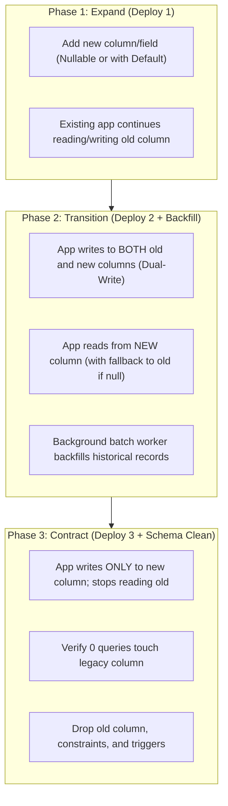

# Parallel Change & Expand-Contract Pattern

One idea: **never execute a breaking schema or contract change in a single step in production**. Instead, split the change into three distinct phases (**Expand**, **Transition / Migrate**, and **Contract**) across separate deployments so that old and new versions of application code can run simultaneously without downtime or data loss. Sources and their claims: [references/sources.md](references/sources.md).

## Vocabulary (Danilo Sato, Martin Fowler & Prisma Data Guide)

| Term | Meaning | Test sentence |
|---|---|---|
| Breaking Change | an alteration to a database schema, API schema, or class interface that breaks running consumers or queries | "dropping a column or renaming an API field is an immediate breaking change" |
| Parallel Change | an evolutionary design technique that implements a breaking change by introducing the new structure in parallel with the old | "both representations coexist temporarily in production" |
| 1. Expand Phase | adding the new column, table, or API field alongside the existing one without altering or breaking existing consumers | "non-breaking schema expansion; nullable or default-valued" |
| 2. Transition Phase | updating application code to write to both representations and read from the new one, backfilling legacy data asynchronously | "dual-write in place, background worker backfills historic rows" |
| 3. Contract Phase | removing the old column, table, trigger, or legacy endpoint once all consumers and rows have migrated | "safe cleanup only after zero callers touch the legacy field" |
| Dual-Writing | writing mutations to both the old and new columns or data stores during the transition period | "guarantees rollback capability if the new code fails" |

---

## The Three Discrete Phases

---

## When It Earns Its Keep

- **Production Relational Databases:** Zero-downtime environments where running instances cannot be stopped for maintenance windows.
- **Microservice APIs & Public SDKs:** Evolving REST/gRPC contracts consumed by mobile apps or third-party clients that cannot be upgraded simultaneously.
- **Distributed Event Streams:** Changing event payloads in Kafka/RabbitMQ while legacy consumers are still processing old message formats.

## Common Mistakes to Catch

1. **Adding a `NOT NULL` constraint without a default in Phase 1:** Instantly crashes existing app instances when they insert rows without knowing about the new column.
2. **Dropping the old column before all app instances are running Phase 3:** In rolling deployments, instances running old code will crash when querying the dropped column.
3. **Synchronous bulk backfill in production:** Locking millions of rows in a single transaction causes database deadlocks and timeouts. Always backfill in small, throttled batches (e.g., 500 rows per batch).
4. **Skipping rollback planning:** Dual-writing allows you to safely rollback to Phase 1 code if Phase 2 introduces critical bugs.

## Quick Decision Checklist

- [ ] Is the breaking change split into Expand, Transition and Contract across separate deployments?
- [ ] Is the new column or field nullable or defaulted in the Expand phase?
- [ ] Does the Transition phase write to both representations and read from the new one?
- [ ] Is the backfill done in small, throttled batches rather than one bulk transaction?
- [ ] Do I have a rollback plan relying on dual-writing?
- [ ] Have I verified zero queries touch the legacy field before dropping it?
- [ ] Are all app instances running Phase 3 code before the old column is dropped?

## Deep references

- [Parallel change phases and variants](references/parallel-change-phases-and-variants.md) — code/API refactoring, feature flags, branch by abstraction, caveats
- [Database expand/contract playbook](references/database-expand-contract-playbook.md) — seven-step schema migration, dual writes, backfill, rollback limits
