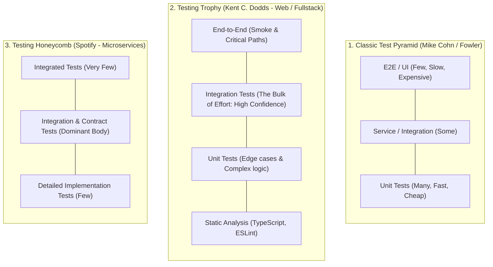

# Automated Testing Shapes: Pyramid, Trophy & Honeycomb

One idea: balance your automated testing portfolio so you achieve **maximum confidence per second of CI build time** — selecting the test shape that matches your system architecture instead of dogmatically insisting on one rigid formula. Sources and their claims: [references/sources.md](references/sources.md).

## Comparison of the Three Major Testing Shapes

---

## Vocabulary (Martin Fowler, Kent C. Dodds, Ham Vocke)

| Term | Meaning | Test sentence |
|---|---|---|
| Solitary Unit Test | a test that isolates the unit under test using test doubles (mocks/stubs) for all collaborators | "runs purely in memory without touching real dependencies" |
| Sociable Unit Test | a test that executes the unit along with its real, in-memory domain collaborators without mocking | "tests the module as a cohesive behavioral unit" |
| Integration Test | tests whether independent modules, databases, network clients, or external subsystems interact correctly | "tests against a real local database or container" |
| Consumer-Driven Contract Test | verifies that a microservice satisfies the expectations of its consumers without spinning up end-to-end environments | "Pact / Spring Cloud Contract checking boundary schemas" |
| Ice Cream Cone (Inverted Pyramid) | an anti-pattern with few unit tests, few integration tests, and a bloated, flaky suite of manual/E2E UI tests | "takes 4 hours to run CI and breaks on random CSS changes" |

---

## Which Shape Fits Your Architecture?

1. **Rich Domain Monoliths / Framework Engines:** **Classic Test Pyramid**. Thousands of millisecond-fast unit tests protecting domain invariants, backed by route-level integration tests and minimal smoke E2E.
2. **Modern Web SPAs & Full-Stack Apps:** **Testing Trophy**. Heavy emphasis on integration tests testing components as users interact with them (e.g., React Testing Library), supported by strict TypeScript static typing.
3. **Microservice Fleets & Distributed APIs:** **Testing Honeycomb**. Focus primarily on integration and contract testing between service boundaries, minimizing fragile cross-service end-to-end tests.

## Quick Decision Checklist

- [ ] Did I match the shape to the architecture: Pyramid, Trophy or Honeycomb?
- [ ] For a rich-domain monolith, are fast unit tests the base with minimal smoke E2E?
- [ ] For a web SPA or full-stack app, is integration the bulk, supported by static typing?
- [ ] For microservices, do integration and contract tests dominate over fragile cross-service E2E?
- [ ] Am I avoiding the ice cream cone of few unit tests and a bloated, flaky E2E suite?

## Deep references

- [The Practical Test Pyramid, Layer by Layer](references/practical-pyramid-layer-by-layer.md) — read when deciding what belongs in unit, integration, contract, UI or E2E tests.
- [Test Shapes Debate and the Integration-First View](references/shapes-debate-and-integration-first.md) — read when choosing pyramid vs trophy vs honeycomb or arguing about mocking and coverage.
- [Avoiding Duplication, Pipeline Placement and Test Code Hygiene](references/duplication-pipeline-and-test-code-hygiene.md) — read when pruning a suite, staging CI, or reviewing test code quality.
