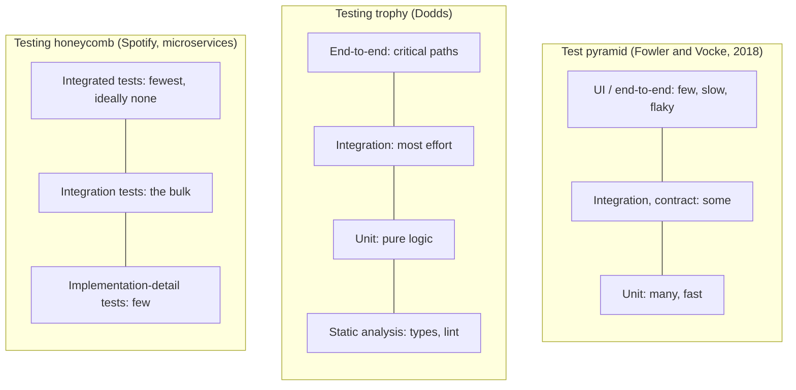

# Automated Testing Shapes: Pyramid, Trophy and Honeycomb

One idea: **get the most confidence per second of CI time by placing each behavior at the lowest level that can prove it, and pick the shape from the architecture, not from a slogan.** The shapes mostly disagree about words (what "unit" and "integration" mean), so define the terms first. Sources, fetch statuses and claims not adopted: [references/sources.md](references/sources.md).

## 1. The three shapes (as their authors describe them)

## 2. Vocabulary to fix before debating ratios

| Term | Meaning |
|---|---|
| Solitary unit test | The unit runs with test doubles for its collaborators |
| Sociable unit test | The unit runs with its real in-process collaborators |
| Integration test | One integration point (database, filesystem, another service) is real and the rest doubled |
| Consumer-driven contract test | The consumer states what it needs, the provider replays it in its own pipeline |
| Ice-cream cone | Few fast tests under a bloated, slow, flaky UI suite (the pyramid upside down) |

Fowler (2021) notes the honeycomb camp's "unit test" is the solitary kind, so much of the pyramid-versus-honeycomb fight is moot once terms are agreed; the deeper issue is tests without clear boundaries that are slow or fail for uninteresting reasons. Detail: [shapes debate](references/shapes-debate-and-integration-first.md).

## 3. Which shape fits (this skill's own synthesis, not a source rule)

1. Rich domain logic or an engine: pyramid. Many fast unit tests on invariants, route-level integration tests, a few smoke journeys.
2. Web front end or full-stack app: trophy. Static types and lint underneath, most effort in integration tests that exercise components as users do. Dodds ties this to modern front-end tooling making such tests cheap.
3. Service fleet: honeycomb. Test each service through its interaction points, add consumer-driven contracts between teams, keep cross-service end-to-end tests rare.

State the reason in the repo's test docs. If the architecture is mixed, pick per module, not per company.

## 4. Placement rules

- Put each test at the lowest level that proves the behavior; if a high-level test fails and no lower one does, add the lower one; delete high-level tests a lower one already covers (sunk cost is not a reason to keep them). Layer detail: [layer by layer](references/practical-pyramid-layer-by-layer.md).
- Mock only what you cannot run (payments, email, third-party APIs); each mock removes confidence in the real connection. Write route tests on critical flows with `integration-tests`.
- Do not mandate a coverage number; Dodds calls a 100% mandate a bad idea and admits his 70% figure is invented. Use incident history to choose the next test.
- Stage the pipeline by speed and scope, not by test label. Detail: [duplication, pipeline and hygiene](references/duplication-pipeline-and-test-code-hygiene.md).

## Quick Decision Checklist

- [ ] Did we define "unit" and "integration" before arguing about ratios?
- [ ] Is the shape chosen from the architecture, with the reason written down?
- [ ] Does each new test sit at the lowest level that proves its behavior?
- [ ] For each bug that escaped, was a lowest-layer regression test added?
- [ ] Are third-party boundaries the only mocks?
- [ ] Is the end-to-end layer a handful of journeys with its flake rate tracked?
- [ ] Is the pipeline staged by speed and scope?

## Deep references

- [Sources](references/sources.md) — fetch statuses, claims not adopted.
- [Trigger evals](references/trigger-evals.md) — should-trigger and near-miss prompts.
- [The Practical Test Pyramid, layer by layer](references/practical-pyramid-layer-by-layer.md) — read when deciding what belongs in unit, integration, contract, UI or end-to-end tests.
- [Test shapes debate and the integration-first view](references/shapes-debate-and-integration-first.md) — read when choosing pyramid vs trophy vs honeycomb or arguing about mocking and coverage.
- [Duplication, pipeline placement and test code hygiene](references/duplication-pipeline-and-test-code-hygiene.md) — read when pruning a suite, staging CI, or reviewing test code quality.
