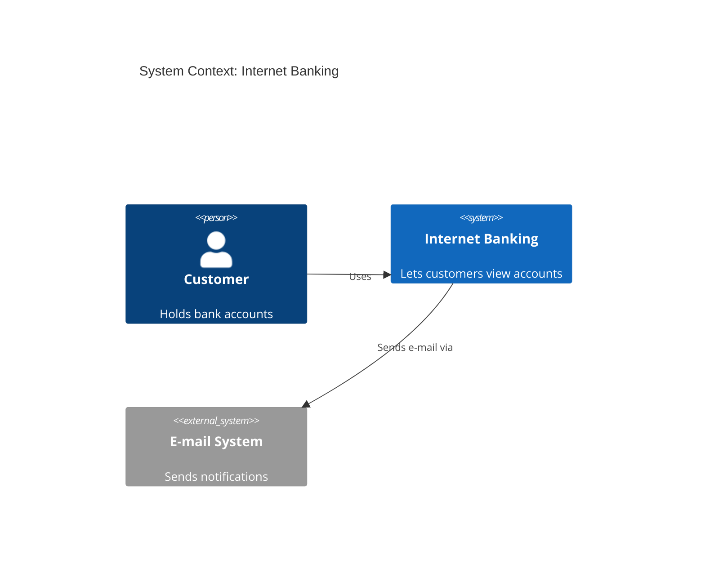
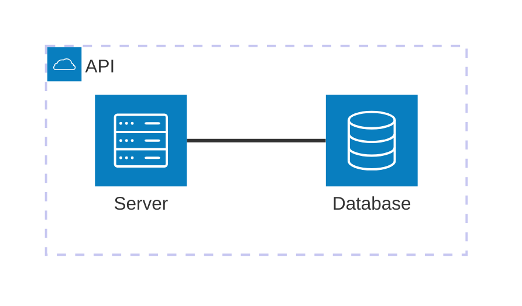

# C4 and Architecture (`architecture-beta`) Diagrams

Sources: https://mermaid.js.org/syntax/c4.html · https://mermaid.js.org/syntax/architecture.html · Last verified 2026-11-23

## C4 in Mermaid
Five types: `C4Context`, `C4Container`, `C4Component`, `C4Dynamic`, `C4Deployment`. Syntax follows C4-PlantUML, but layout comes from statement order (no automatic algorithm) and styling is fixed (no skins or CSS).

### Macro catalog (parameter lists as documented; `?` = optional, may be named with a `$` prefix)
| Group | Macros |
|---|---|
| People/systems | `Person(alias, label, ?descr, ?sprite, ?tags, $link)`, `System(...)`, plus `Person_Ext`, `System_Ext`, `SystemDb`, `SystemDb_Ext`, `SystemQueue`, `SystemQueue_Ext` |
| Containers | `Container(alias, label, ?techn, ?descr, ?sprite, ?tags, $link)`, `ContainerDb`, `ContainerQueue`, `*_Ext` variants |
| Components | `Component(alias, label, ?techn, ?descr, ?sprite, ?tags, $link)`, `ComponentDb`, `ComponentQueue`, `*_Ext` variants |
| Boundaries | `Boundary(alias, label, ?type, ?tags, $link)`, `Enterprise_Boundary`, `System_Boundary`, `Container_Boundary` |
| Deployment | `Deployment_Node(alias, label, ?type, ?descr, ?sprite, ?tags, $link)`, `Node` (same), `Node_L`, `Node_R` |
| Relations | `Rel(from, to, label, ?techn, ?descr, ?sprite, ?tags, $link)`, `BiRel`, `Rel_U/Up`, `Rel_D/Down`, `Rel_L/Left`, `Rel_R/Right`, `Rel_Back` |
| Dynamic | `RelIndex(index, from, to, label, ...)`: the index is ignored; order follows the `Rel` statements |

### Style and layout controls
- `UpdateElementStyle(elementName, ?bgColor, ?fontColor, ?borderColor, ?shadowing, ?shape, ?sprite, ?techn, ?legendText, ?legendSprite)` and `UpdateRelStyle(from, to, ?textColor, ?lineColor, ?offsetX, ?offsetY)`.
- `UpdateLayoutConfig(?c4ShapeInRow, ?c4BoundaryInRow)`: defaults 4 shapes per row, 2 boundaries per row.
- Not supported: `Lay_U/D/L/R` (not planned). Unfinished per the page: sprites, tags, links, `Legend`, `AddElementTag`, `AddRelTag`, `RoundedBoxShape()`, `EightSidedShape()`, `DashedLine()`, `DottedLine()`, `BoldLine()`. Do not emit these.

(Own sketch composed from documented macros; the page's own examples are longer.)

## `architecture-beta` (v11.1.0+, beta; syntax may change incompatibly)
- Blocks can be declared in any order, but an id must be declared before it is referenced.
- `group id(icon)[Title] (in parent)?`, `service id(icon)[Title] (in parent)?`, `junction id (in parent)?` (a junction is a potential four-way split).
- Edge: `serviceId{group}?:SIDE -- SIDE:serviceId{group}?` where SIDE is `T`, `B`, `L`, `R`; `<` and `>` add arrowheads. The `{group}` modifier applies only to services inside a group, and group ids cannot be used directly in edges.
- Icons: built-in `cloud`, `database`, `disk`, `internet`, `server`; Iconify packs after registration, referenced as `pack:name` (e.g. `logos:aws-s3`).
- Alignment (v11.16.0+): `align row a b c` / `align column a b`, each on its own line, at least two declared services/junctions; use `column` when members connect via the same horizontal port pair (`R --> L`), `row` for vertical pairs (`B --> T`); order must not contradict edge directions or layout fails; combine both for grids.
- Config (frontmatter `config: architecture:`): `randomize` (false, v11.14.0+), `nodeSeparation` 75, `idealEdgeLengthMultiplier` 1.5, `edgeElasticity` 0.45, `numIter` 2500, `seed` 1 (0 = non-deterministic). `randomize: false` alone does not guarantee identical renders; set `seed`.

## Failure modes
- Mixing abstraction levels (containers inside a context diagram).
- Emitting PlantUML-only macros (`Lay_R`, `Legend`): unsupported or unfinished.
- `architecture-beta` edges with ports that contradict `align`: layout failure.
- Using a group id in an edge: invalid.

## How an agent should apply this
- One C4 level per diagram; order statements to steer placement, then tune `UpdateLayoutConfig`.
- Treat C4 and `architecture-beta` as beta-risk on third-party hosts; validate with the target renderer.
- Use `seed` for reproducible architecture layouts in committed docs.
- For abstraction rules (what belongs at which level) defer to `c4-model-architecture`.
- Declare every service before any edge that references it.
