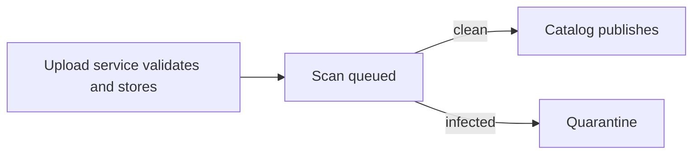

# Does the Diagram Earn Its Place? Gate and Type-per-Need

Sources: https://mermaid.js.org/intro/ · https://mermaid.js.org/syntax/flowchart.html · https://mermaid.js.org/syntax/sequenceDiagram.html · https://mermaid.js.org/syntax/stateDiagram.html · https://mermaid.js.org/syntax/entityRelationshipDiagram.html · Last verified 2026-11-27

The method comes from an internal documentation workflow (generic part only, rewritten here); the syntax facts come from the Mermaid pages above, already summarized in the sibling references.

## The gate (answer before any syntax)

A diagram exists to be read faster than the prose beside it. Draw only when both hold:

1. The content has one of these shapes: an **order** (steps, a cycle, a deploy sequence), an **exchange** (who calls whom), a **lifecycle** (states and the events between them), a **set of relations** (tables, modules), or a **decision path** (if this, then that).
2. Said in words it takes more than about eight lines, or the reader would have to hold the order in their head.

If either fails, write a table (comparing things with the same attributes) or a short list (independent items) and stop. This sharpens `SKILL.md` section 8 ("When NOT to use a diagram"): that section lists exclusions, this one gives the positive test.

**A diagram is never the only carrier of a fact.** Names, numbers, commands, versions and dates stay in the text, once; the diagram shows the shape and the text holds the values. Reasons (inference): diagrams are not searchable by many tools, are not read by agents that skip fences, and drift silently from the prose when only one copy is edited.

## Type per need

| The reader must see | Type | Typical subject |
|---|---|---|
| Who calls whom, in order | `sequenceDiagram` | A request crossing client, gateway, service and database |
| A pipeline, cycle or order of steps | `flowchart LR` (time) or `TD` (hierarchy) | A nightly job, a deploy order, a promotion path |
| States and the events between them | `stateDiagram-v2` | An order, a provisioning run, a billing period |
| Tables and their relations | `erDiagram` | The entities and keys that matter, not every column |
| A choice that branches | `flowchart TD` with decision nodes | Where a setting lives, which check applies |
| A few dated events in order | `timeline`; a table if fewer than four | A rollout or migration history |
| Module or object structure | `classDiagram` or `flowchart` | Interfaces and who implements them |

`mindmap`, `gantt` and `pie` rarely beat a list in technical docs; require a stated reason before using them. For C4 level discipline see `c4-model-architecture`.

## Sizing and drawing limits that make the gate real

- One idea per diagram; about 12 nodes (7 participants in a sequence) is a comfortable cap for prose-embedded diagrams. Larger means two diagrams plus a sentence that links them. The core skill's 25-30 node ceiling is the hard stop for a standalone artifact; this stricter cap is for documentation pages.
- A lead-in sentence above says what the reader will see; nothing below repeats what the diagram says.
- Color never carries meaning alone: put the meaning in the label too, and color strokes rather than fills so it holds in light and dark themes.
- Draw only what is true: grep each identifier (table, route, job) in the source before keeping it; a diagram of intended behavior is labeled a proposal.
- Edit, do not fork: if a source diagram already exists, change it and its mirrors instead of adding a second drawing of the same thing.
- Placeholders instead of real hostnames, tenant ids, customer names.

## Worked contrast

Prose (too long for its job): "The client posts the file to the upload service, which validates it, stores it, queues a scan, and only when the scan reports clean does the catalog service publish it; otherwise it is quarantined." This is an order with a branch: draw it as a flowchart of five nodes and keep the numbers (size limit, timeout) in the sentence above it.

Counter-case: "Config lives in the vault, falling back to the local file" is two things; a one-line sentence beats a diagram.

## How an agent should apply this

- Run the gate first; if it fails, produce a table or list and say why no diagram was drawn.
- Choose the type from the table, then list nodes on paper; split above the cap.
- Keep every fact (names, numbers, commands) in the text once, never only inside a diagram.
- Ground every drawn identifier in the source, and report whether a real renderer ran.
