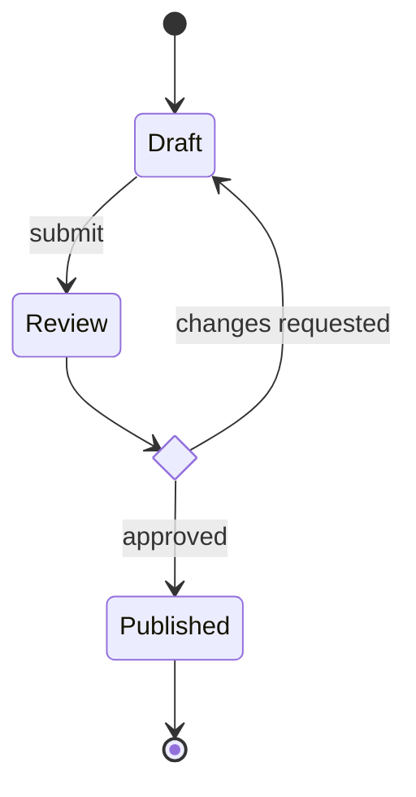
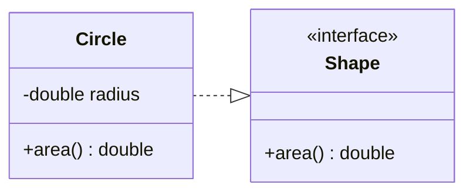

# ER, State, and Class Diagrams: Detail Reference

Sources: https://mermaid.js.org/syntax/entityRelationshipDiagram.html · https://mermaid.js.org/syntax/stateDiagram.html · https://mermaid.js.org/syntax/classDiagram.html · Last verified 2026-11-23

## ER diagrams
- Statement: `<first-entity> [<relationship> <second-entity> : <label>]`; the label reads from the first entity's perspective.
- Marker pairs: each side has two characters, outer = maximum, inner = minimum.

| Left | Right | Meaning |
|---|---|---|
| `\|o` | `o\|` | zero or one |
| `\|\|` | `\|\|` | exactly one |
| `}o` | `o{` | zero or more |
| `}\|` | `\|{` | one or more |

- Word aliases exist (`zero or more`, `one or many`, `only one`, `1`, `0+`, `1+`, `many(0)`...), and `to` / `optionally to` replace `--` / `..`: `CAR 1 to zero or more NAMED-DRIVER : allows`.
- `--` identifying (solid), `..` non-identifying (dashed).
- Attributes: `type name [keys] ["comment"]`. Types start with a letter and may contain digits, hyphens, underscores, parentheses, square brackets (`string(99)`). Keys `PK`, `FK`, `UK`, comma-separated; names may begin with `*` to mark a primary key. Comments cannot contain double quotes. Optional types with `?` (v11.16.0+): `string? middleName`.
- Entity alias: `p[Person]`; quote aliases with spaces (`a["Customer Account"]`).
- `direction LR|RL|TB|BT` inside the diagram; styling with `style`, `classDef`, `class`, `:::`.
- Since v12.0.0 ER defaults to `redux-color`, `neo`, ELK; restore with `theme: default`, `look: classic`, `layout: dagre`.

```mermaid
erDiagram
    direction LR
    CUSTOMER ||--o{ ORDER : places
    ORDER ||--|{ LINE_ITEM : contains
    ORDER {
        int id PK
        int customerId FK
        string? note "free text"
    }
```

## State diagrams
- Declare: bare id, `state "Long description" as s2`, or `s2 : description`. Names with spaces need the id-plus-description form.
- Transition `s1 --> s2: label`; undeclared states are created on first use; `[*]` is start or end depending on arrow direction.
- Composite: `state Name { ... }`, nestable; transitions between composites are fine, but not between internal states of different composites.
- `<<choice>>`, `<<fork>>`, `<<join>>` via `state x <<choice>>`; concurrent regions separated by `--` inside a composite.
- Notes: `note right of S1 ... end note` or `note left of S2 : text`.
- `direction LR` at top level or inside a composite. Comments `%%`.
- `classDef` / `class` / `:::` work, but cannot style start/end states or composites (documented limitation).
- Use `stateDiagram-v2`; the docs still show the older `stateDiagram` renderer.



## Class diagrams
- Declaration: `class Animal`, implicit via relationship, label form `class Animal["Animal with a label"]`, backtick names for specials.
- Members: `Class : +String owner` or brace block; `()` marks a method; return type after `)`: `+deposit(amount) bool`. Visibility `+ - # ~`; classifiers `*` (abstract method) and `$` (static). Generics `List~int~`, nestable, no commas.
- Relations: `<|--`, `*--`, `o--`, `-->`, `--`, `..>`, `..|>`, `..`; reversed forms like `--|>` allowed; two-way `Animal <|--|> Zebra`; labels `A <|-- B : implements`; lollipop `bar ()-- foo`.
- Cardinality as quoted strings around the arrow: `Customer "1" --> "*" Ticket`; values `1`, `0..1`, `1..*`, `*`, `n`, `0..n`, `1..n`, or free text.
- Annotations (`<<interface>>`) inline, on a separate line, or inside the body.
- Notes: `note "text"`, `note for MyClass "text"`.
- Namespaces: `namespace BaseShapes { class Triangle }`; labels, dot notation and nesting from v11.15.0+; `hierarchicalNamespaces: false` under `config.class` renders flat boxes.
- Styling: `style`, `classDef a,b ...`, `cssClass "id1,id2" name;`, `:::` (cannot share a line with a relation). Notes and namespaces cannot be individually styled.
- `config: class: hideEmptyMembersBox: true` hides empty member boxes.



## Failure modes
- ER cardinality markers typed from memory (e.g. `||--o{` vs `}o--||`): flips semantics silently; copy from the table.
- State transitions across composite boundaries: parse or render failure.
- Commas inside class generics: unsupported.

## How an agent should apply this
- For schemas, read DDL first, then map FK direction to the marker table; keep entity names uppercase and aliases for display.
- Use `stateDiagram-v2` with explicit labels on every transition and a `<<choice>>` for guards.
- Keep class diagrams to one module; use namespaces instead of one giant diagram.
- After styling, confirm that start/end and composite states were not the styling target.
- Add `direction` only when the default orientation hurts readability.
