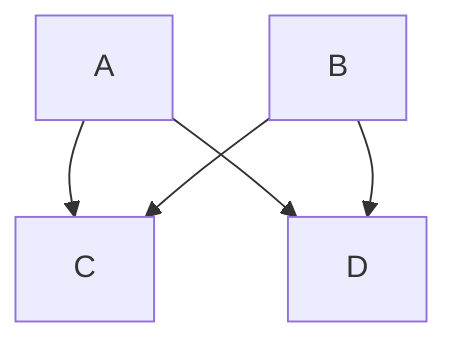
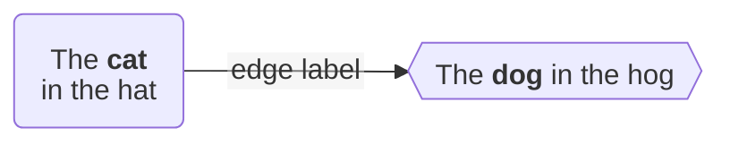
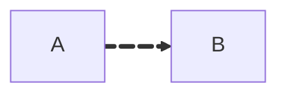

# Flowchart: Edges, Chaining, Subgraphs, Styling, Escaping

Sources: https://mermaid.js.org/syntax/flowchart.html · Last verified 2026-11-23

Complements the flowchart notes already in `SKILL.md`; this file covers the parts the cheatsheet omits.

## Edge forms
| Need | Syntax |
|---|---|
| Arrow / open link | `A --> B`, `A --- B` |
| Text on link | `A -- text --- B` or `A ---|text| B` |
| Dotted / thick | `A -.-> B`, `A ==> B`; with text `A -. text .-> B`, `A == text ==> B` |
| Invisible (layout only) | `A ~~~ B` |
| Circle / cross ends | `A --o B`, `A --x B` |
| Multi-directional | `A o--o B`, `B <--> C`, `C x--x D` |
| Longer span | extra dashes: `B ---->|No| E` (with inline label, dashes go on the right: `B -- No ----> E`; use `=` or `.` for thick/dotted) |

The renderer may lengthen links further to satisfy other constraints, so dash count is a hint, not a guarantee.

## Chaining with `&`

Expands to four edges (A-C, A-D, B-C, B-D). The page warns that heavy one-liners hurt readability; fall back to one edge per line when reviewing.

## Markdown strings
Backtick-in-quotes labels give bold (`**`), italics (`*`) and automatic wrapping; a real newline starts a new line, so ` ` is unnecessary. Works for node, edge and subgraph labels. Set `htmlLabels: false` as in the page's example; auto-wrap can be disabled with `markdownAutoWrap: false`.

## Subgraphs
- `subgraph id [Title]` ... `end`; edges may target a subgraph id directly.
- `direction` inside a subgraph works only if no node inside links to a node outside; otherwise the subgraph inherits the parent direction.
- Collapsible (v11.17.0+): add `one@{ view: collapsed }` after the subgraph; the group becomes one node and crossing edges are redirected to it.

## Styling
- Edges are numbered in definition order for `linkStyle 3 stroke:#ff3,stroke-width:4px;`; a list (`linkStyle 1,2,7 color:blue;`) or `default` targets several.
- Curves: `basis`, `bumpX`, `bumpY`, `cardinal`, `catmullRom`, `linear`, `monotoneX`, `monotoneY`, `natural`, `step`, `stepAfter`, `stepBefore`. Diagram-wide via `config: flowchart: curve: stepBefore`; per edge (v11.10.0+) via `e1@{ curve: linear }`, which overrides the diagram setting (last change wins).
- Nodes: `style id1 fill:#f9f,stroke:#333,stroke-width:4px`; classes with `classDef name ...;`, `class a,b name;` or `A:::name`; a class called `default` applies to unclassed nodes.
- External CSS rarely works because Mermaid's styles use `!important` and are scoped to the SVG id; use `classDef`.

## Edge ids and animation

`animation: fast` or `slow` sets speed. A class can drive animation too (escape commas in `stroke-dasharray` as `\,`). Step animation (v12.3.0+): `e1@{ step: 1 }`, speed via `flowchart.stepDuration` (seconds), badges via `flowchart.stepNumbers: true`; hidden under reduced-motion preference.

## Click interaction
`click A callback "Tooltip"`, `click B "https://example.com" "Tooltip"`, `click C href "https://example.com" _blank` (targets `_blank`, `_self`, `_parent`, `_top`). Disabled when `securityLevel='strict'`, enabled with `'loose'`. Do not rely on clicks in GitHub-rendered Markdown (inference from strict-by-default hosting; not stated on this page).

## Escaping and keywords
- Quote text containing parentheses etc.: `id1["This is the (text) in the box"]`.
- Entity codes: `#quot;`, `#9829;`, and `#35;` for `#`.
- Lowercase `end` in a label breaks the chart (use `End`/`END`); a node id starting with `o` or `x` after `---` becomes a circle/cross edge (`dev--- ops` or `dev---Ops`).

## Layout config
ELK is the default engine since v12.0.0; `layout: dagre` opts out. The old `defaultRenderer` option was removed in v12 and the `flowchart-elk` type is no longer needed.

## How an agent should apply this
- Use `&` only for fan-in/fan-out of 2x2 or smaller; otherwise one edge per line.
- Prefer `classDef` plus `:::` over per-node `style` lines when more than two nodes share a look.
- When a requested `direction` inside a subgraph is ignored, check for edges crossing its boundary before changing anything else.
- Name edges (`e1@`) only when animating or overriding curves; do not add ids otherwise.
- Always quote labels with punctuation and scan ids for leading `o`/`x` after `---`.
