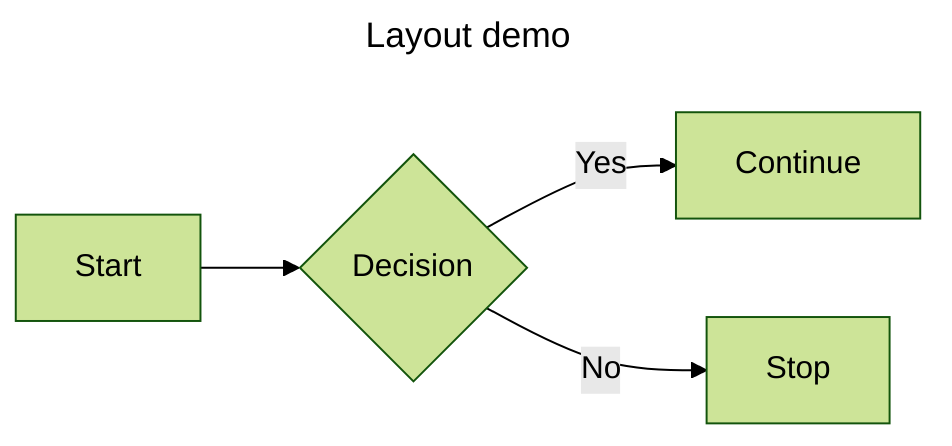
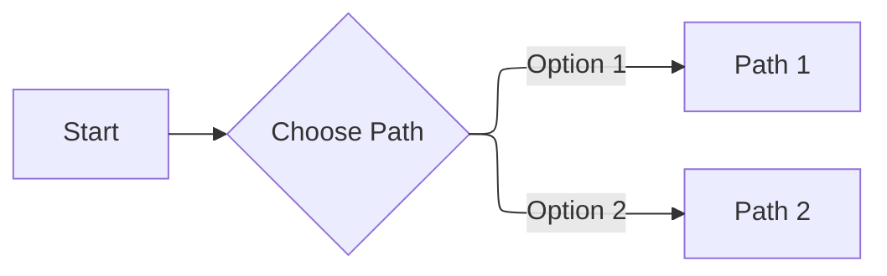

# Parsing Rules, Frontmatter, Looks, and Layout Engines

Sources: https://mermaid.js.org/intro/syntax-reference.html · Last verified 2026-11-23

## Parsing model
- Every diagram starts with a type declaration; YAML frontmatter is the only thing allowed before it. The type keyword tells the parser which grammar to use.
- Unknown words and misspelled keywords break rendering. Misspelled configuration *parameters* fail silently (ignored); a malformed parameter value breaks the diagram. Treat "diagram renders but looks default" as a likely misspelled config key.
- Words that break diagrams, per the page: `end` (flowchart and sequence; wrap in quotes), nested shapes (quote the labels), and `%%{ }%%` text inside comments.
- Comments: `%%` starts a line comment. Avoid `{}` inside comment text because it resembles directive syntax.

## Frontmatter
- Fenced by `---` lines; the opening `---` must be alone on the first line.
- YAML indentation must be consistent and keys are case-sensitive.
- Carries `title`, `config:` (theme, look, layout, per-diagram blocks such as `flowchart:` or `architecture:`) and diagram-specific keys.

## Directives
`%%{ }%%` directives (above or below the definition) allow limited reconfiguration just before render (fonts, colors). The page gives no sample and treats frontmatter as the primary mechanism; prefer frontmatter for new diagrams.

## Themes and looks
- Themes named on the page: `default`, `forest`, `neutral`, `dark`, plus `base` and the `redux-color` family. On `base`, a gradient is on by default; setting a custom `nodeBorder` turns it off unless `useGradient: true` is also set.
- Looks: `neo` (flatter, rounded, subtle shadows; designed for `redux-color` themes and the default for the listed diagram types), `classic` (traditional; default for the other types), `handDrawn` (sketch style).
- The page lists no per-diagram default table, so when portability matters set `theme`, `look`, and `layout` explicitly.

## Layout engines
- Layout selection applies to flowchart, state, class, ER, requirement, use case and agentflow diagrams; the page says other types are planned. Mindmaps keep their own `cose-bilkent` layout unless set.
- ELK is the default and ships with Mermaid; Dagre via `layout: dagre`. The "tiny" build omits ELK and falls back to Dagre.
- ELK options: `mergeEdges` (combine parallel edges), `nodePlacementStrategy` (`SIMPLE`, `NETWORK_SIMPLEX`, `LINEAR_SEGMENTS`, `BRANDES_KOEPF` default), `nodePlacementAlignment` (`NONE`, `LEFTUP`, `LEFTDOWN`, `RIGHTUP`, `RIGHTDOWN`, `BALANCED`). If alignment is unset, `elk.preset` decides: `BALANCED` for `default`, `NONE` for `legacy`, `modelOrder`, `depthFirst`; `preset: depthFirst` restores the former layout.

JavaScript API equivalent: `mermaid.initialize({ look: 'handDrawn', layout: 'elk' });`. The separate `@mermaid-js/layout-elk` package is only needed for builds without bundled ELK.

## Failure modes
- Setting `layout: elk` in a host whose Mermaid build is tiny: silently falls back to Dagre, so output differs from the preview.
- Indentation or key-case errors in frontmatter: keys ignored, diagram looks unthemed.
- `%%{...}%%` inside a comment line: breaks the renderer.

## How an agent should apply this
- Put frontmatter on line 1 and verify `---` is alone on its line before editing anything else.
- When a styled diagram renders unstyled, check key spelling and case before changing the diagram body.
- Pin `theme`, `look` and `layout` in frontmatter for diagrams that will be viewed on several hosts.
- Use ELK options only after the target renderer is confirmed to bundle ELK.
- Keep comments free of braces and of `%%{`.
