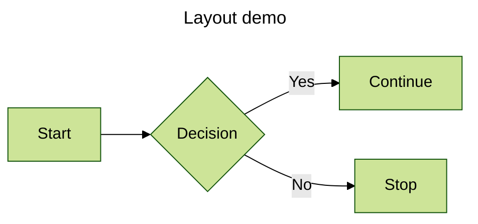
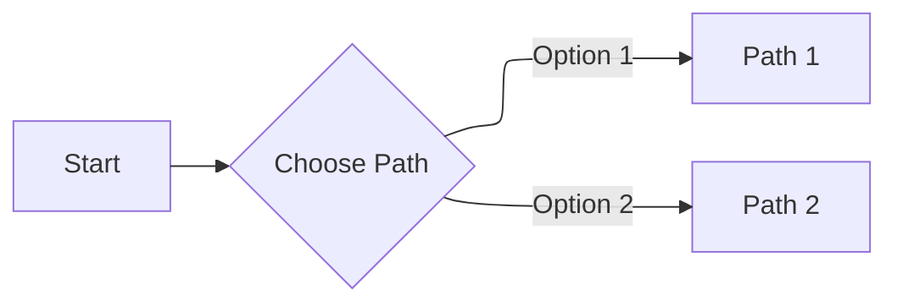

# Parsing Rules, Frontmatter, Looks, and Layout Engines

Sources: https://mermaid.js.org/intro/syntax-reference.html · https://mermaid.js.org/config/theming.html · https://mermaid.js.org/config/layouts.html · https://mermaid.js.org/config/schema-docs/config.html · Last verified 2026-11-27

## Parsing model
- Every diagram starts with a type declaration; YAML frontmatter is the only thing allowed before it. The type keyword tells the parser which grammar to use.
- Unknown words and misspelled keywords break rendering. Misspelled configuration *parameters* fail silently (ignored); a malformed parameter value breaks the diagram. Treat "diagram renders but looks default" as a likely misspelled config key.
- Words that break diagrams, per the page: `end` (flowchart and sequence; wrap in quotes), nested shapes (quote the labels), and `%%{ }%%` text inside comments.
- Comments: `%%` starts a line comment. Avoid `{}` inside comment text because it resembles directive syntax.

## Frontmatter
- Fenced by `---` lines; the opening `---` must be alone on the first line.
- YAML indentation must be consistent and keys are case-sensitive.
- Carries `title`, `config:` (theme, look, layout, per-diagram blocks such as `flowchart:` or `architecture:`) and diagram-specific keys.

## Directives
`%%{ }%%` directives (above or below the definition) allow limited reconfiguration just before render (fonts, colors). The page gives no sample and treats frontmatter as the primary mechanism; prefer frontmatter for new diagrams.

## Themes and looks
- Themes (theming page, 11 named): `default`, `neutral`, `dark`, `forest`, `base`, `neo`, `neo-dark`, `redux`, `redux-dark`, `redux-color`, `redux-dark-color`; the config schema also allows `null` (no predefined theme). Only `base` can be customized with `themeVariables`, and only hex colors are recognized. `dark` needs `darkMode: true` for a dark background. (A `base` gradient detail from an earlier draft was not re-verified and is not adopted.)
- Looks: `classic` (global default), `neo` (intended to pair with the neo and redux themes; the v12.0.0 default for flowchart, ER, state, class and sequence), `handDrawn`.
- When portability matters set `theme`, `look`, and `layout` explicitly.

## Layout engines
- ELK is the default and bundled from v12.0.0 for flowchart, state, class, ER, requirement, use case and agentflow diagrams; Dagre via `layout: dagre`. Mindmaps keep `cose-bilkent` unless set. The "tiny" build omits ELK and falls back to Dagre. A layered layout is beta from v12.3.0.
- ELK tuning options (`mergeEdges`, `nodePlacementStrategy`, `nodePlacementAlignment`, `elk.preset`) were in an earlier draft but could not be confirmed on the layouts page: not adopted, see `sources.md`.

JavaScript API equivalent: `mermaid.initialize({ look: 'handDrawn', layout: 'elk' });`. The separate `@mermaid-js/layout-elk` package is still published so the tiny build can opt back in.

## Failure modes
- Setting `layout: elk` in a host whose Mermaid build is tiny: silently falls back to Dagre, so output differs from the preview.
- Indentation or key-case errors in frontmatter: keys ignored, diagram looks unthemed.
- `%%{...}%%` inside a comment line: breaks the renderer.

## How an agent should apply this
- Put frontmatter on line 1 and verify `---` is alone on its line before editing anything else.
- When a styled diagram renders unstyled, check key spelling and case before changing the diagram body.
- Pin `theme`, `look` and `layout` in frontmatter for diagrams that will be viewed on several hosts.
- Choose `layout: elk` only after the target renderer is confirmed to bundle ELK.
- Keep comments free of braces and of `%%{`.
