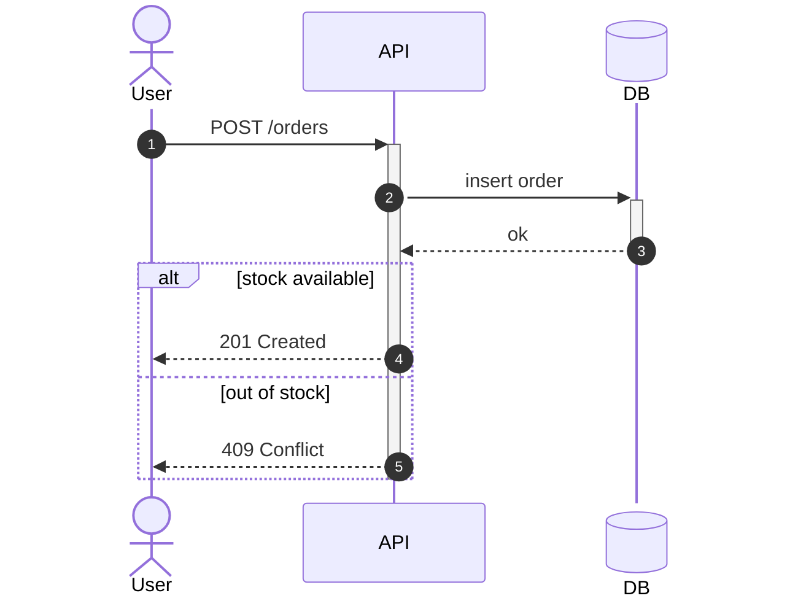

# Sequence Diagrams: Participants, Arrows, Blocks, Config

Sources: https://mermaid.js.org/syntax/sequenceDiagram.html · Last verified 2026-11-23

## Participants and actors
- Order of first appearance sets column order unless participants are declared first.
- `actor` draws a stick figure. Stereotype symbols use a JSON-style suffix: `participant Alice@{ "type" : "boundary" }`; types listed: `boundary`, `control`, `entity`, `database`, `collections`, `queue`.
- Aliases: `participant A as Alice`, or inline `participant API@{ "type": "boundary", "alias": "Public API" }`; if both are given the external `as` label wins. Line breaks in a participant name require an alias.
- Lifecycle (v10.3.0+): `create participant B` immediately before the first message to B; `destroy Carl` before the final message involving Carl.
- Grouping: `box Purple Alice & John` ... `end`. Colors may be named, `rgb()`, `rgba()`, `hsl()`, `hsla()`; hex is unsupported because `#` starts an entity/comment parse. `box transparent Aqua` makes a named-color group transparent.

## Arrows
| Syntax | Meaning |
|---|---|
| `->` / `-->` | solid / dotted line, no head |
| `->>` / `-->>` | solid / dotted with arrowhead |
| `<<->>` / `<<-->>` | bidirectional (v11.0.0+) |
| `-x` / `--x` | cross at end |
| `-)` / `--)` | open arrow (async) |

Half-arrow and central-connection variants (v11.12.3+) exist (`Alice->>()John: Hello John` connects to a central lifeline); verify against the target renderer before using.

## Activations
Explicit `activate John` / `deactivate John`, or shortcut `Alice->>+John: ...` and `John-->>-Alice: ...`. Activations on the same actor stack.

## Notes and breaks
`Note right of John: Text`, `Note left of ...`, `Note over Alice,John: Text`. Use ` ` for line breaks in messages and notes.

## Control blocks (all end with `end`)
| Block | Shape |
|---|---|
| `loop` | `loop Every minute` |
| `alt` / `else` | `alt is sick` ... `else is well` |
| `opt` | `opt Extra response` (no else) |
| `par` / `and` | `par Alice to Bob` ... `and Alice to John` (nesting allowed) |
| `critical` / `option` | `critical Establish a connection` ... `option Network timeout` |
| `break` | `break when the booking process fails` |
| `rect` | `rect rgb(191, 223, 255)` or `rect rgba(0, 0, 255, .1)` |

## Text escaping
Entity codes work in messages (`A->>B: I #9829; you!`). A literal semicolon must be `#59;` because `;` separates statements. Comments (`%%`) must be on their own line. `end` in text can break the diagram; wrap in `()`, `[]`, `{}` or quotes.

## Numbering and menus
`autonumber`; `autonumber <start> <increment>` (v11.15.0+, decimals to hundredths allowed). Global: `mermaid.initialize({ sequence: { showSequenceNumbers: true } })`. Actor menus: `link Alice: Dashboard @ https://...` or JSON `links`.

## Configuration
Set via `mermaid.sequenceConfig` (examples: `diagramMarginX`, `messageMargin`, `mirrorActors`). Documented defaults include `mirrorActors: false`, `actorFontSize`/`noteFontSize` 14, `messageFontSize` 16, `noteAlign` center. From v12.0.0 sequence diagrams default to `redux-color` theme and `neo` look; `theme: default` plus `look: classic` restores the old appearance.

## Minimal valid example

(Own sketch built from documented constructs; the single `+` on API is closed by an explicit `deactivate` after the `alt` block.)

## Failure modes
- Hex color in `box`: parse error or comment cut-off.
- Unescaped `;` in message text: statement split.
- Creating a participant with `create` after it already sent messages: invalid lifecycle ordering (inference from the "before a message" rule).

## How an agent should apply this
- One scenario per diagram; declare participants first to control column order.
- Use `->>` for calls and `-->>` for replies; reserve `-)` for fire-and-forget.
- Balance every `+` with a `-`, preferably outside `alt` branches.
- Escape `;` and `#` in message text before validating.
- Never reorder messages when repairing; sequence order is the semantics.
