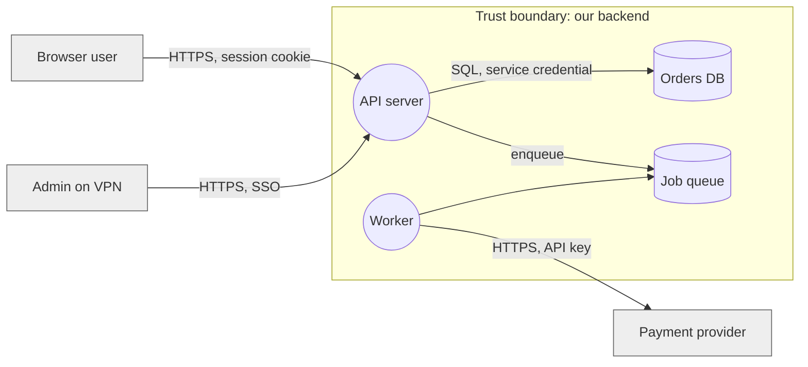

# DFD and Trust Boundaries

Sources: https://cheatsheetseries.owasp.org/cheatsheets/Threat_Modeling_Cheat_Sheet.html · https://shostack.org/resources/threat-modeling · https://learn.microsoft.com/en-us/azure/security/develop/threat-modeling-tool-getting-started · https://learn.microsoft.com/en-us/windows-hardware/drivers/driversecurity/threat-modeling-for-drivers · Last verified 2026-11-27

## What the model must answer

The first of the four questions ("what are we working on?") is answered by a model that everyone shares. Shostack's page recommends data flow diagrams (DFDs) because threats tend to follow data; it adds message sequence diagrams to expand one DFD arrow into the actual calls. The OWASP cheat sheet agrees that DFDs are the most common approach and says a DFD should show trust boundaries, data flows, data stores, processes and external entities. The Microsoft tool guide describes the same notation: an outside entity as a square, a process as a circle, a data store as two parallel lines, and trust boundaries as dotted lines showing where different parties are in control.

## Element types and what they mean for code

| Element | In a typical web or API system | Question to ask while drawing |
|---|---|---|
| External entity | Browser, mobile app, partner API, identity provider, payment provider, an operator's laptop | Who controls it? Can we trust anything it sends? |
| Process | API server, worker, serverless function, cron job, CI runner, admin UI | What input does it accept, with what privileges does it run? |
| Data store | Database, object storage, cache, queue, secret store, log sink, local file | Who can read and write it directly, bypassing the app? |
| Data flow | HTTP call, message, DB query, file read, webhook | Which protocol, which authentication, which direction? |
| Trust boundary | Internet/server, browser/API, API/database, service/service, tenant/tenant, app/third party | Who enforces what when data crosses? |

## Placing trust boundaries (decision rules)

Draw a boundary where any of these change:

1. **Who controls the machine or the code** (your service vs a vendor's).
2. **Privilege level** (anonymous vs signed in vs admin; app role vs database owner).
3. **Network zone** (internet, internal network, management plane).
4. **Tenant** (one customer's data vs another's, even inside one database).
5. **Build and run** (developer machine, CI, registry, production). The pipeline is a process with powerful credentials and belongs in the model.

The OWASP cheat sheet notes that boundaries often mark likely attack points and feed the threat step. Practical corollary (this skill's inference): the client is always on the far side of a boundary, so anything the client sends or hides is input, never a control (`never-trust-the-client`).

## Levels of detail

An overview plus detail diagrams for the risky areas is this skill's practice. The Windows driver guide shows the same idea: one circle ("handle I/O requests") expanded into separate processes per request type. Rule of thumb: stop descending when each element has one owner and one trust level. Expand only the flows that cross a boundary, carry sensitive data, or have no known control.

## Worked example (text diagram)

Reading it: three boundary crossings (user to API, admin to API, worker to provider); the API-to-DB hop sits inside the backend boundary but still deserves the question "who else can reach the database directly?". Each crossing is where STRIDE prompts start: Is the session cookie the only proof (S)? Can the user alter an order id (T, E)? Are admin actions logged (R)? Does the worker log the provider key (I)?

## Fast path

When time is short, the Windows driver guide offers a summary outline instead of a full diagram: list every entry point and exit point (interfaces, files, registry-like config, callbacks) and examine each for threats. For a web system that is a table of routes, jobs, webhooks, file inputs and admin tools, each with caller, input and privilege. This is a valid first pass, to be upgraded to a diagram when the system or the stakes grow.

## Failure modes

- A diagram of boxes with no boundaries (nothing to attack).
- Arrows without direction, protocol or authentication (cannot reason about S or T).
- The datastore drawn as part of the API process (hides direct access paths).
- Omitting the pipeline, backups, logs and admin tooling, which are common weak points.
- Treating the third party as trusted because it is a known brand; its input is still input.
- A beautiful diagram never compared with code. Validate against routes, config and infrastructure files.

## How an agent should apply this

- Derive the first diagram from code and config (routes, queues, clients, compose or deployment files), mark each element "observed", and mark anything inferred as "assumed".
- Put a boundary line wherever control, privilege, network zone or tenant changes; list what enforces each crossing.
- Include the build pipeline, admin tools and log or backup stores as elements.
- Keep an overview and expand only boundary-crossing or sensitive flows; stop at one owner per element.
- Save the diagram as text beside the code so it can be diffed with the change.
- Ask a human to confirm deployment facts the code cannot show.
