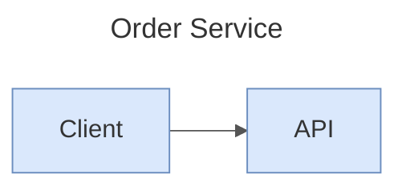

# Mermaid Diagram Engineering

Use this skill whenever an architecture, workflow, data model, state progression, chronology, or entity relationship is clearer as a picture than as dense prose, or when an existing Mermaid block is broken or hard to read. For hierarchical C4 abstraction discipline (what belongs at L1 vs. L2 vs. L3), see `c4-model-architecture`. Sources and claims: [references/sources.md](references/sources.md).

---

## 1. Workflow

1. **Classify** the need and pick the diagram type (section 3). Do not default to `flowchart`.
2. **Inventory first.** List every entity, actor, state or step and every relationship before writing syntax. For code input, read the real files; never invent components.
3. **Write** the diagram. Persist it as a `.mmd` file when it is a standalone artifact; embed it in a fenced ```` ```mermaid ```` block inside Markdown (GitHub Issues, PRs, Wikis, READMEs, `docs/`).
4. **Validate** (section 7) before presenting. Never hand over unvalidated syntax as if it were verified.
5. **Repair** on failure: fix the first reported error, re-validate, repeat. Do not rewrite the diagram wholesale to fix one line.
6. **State what was checked**: say whether a real parser/renderer ran (`mmdc`) or only the manual checklist.

---

## 2. Core Invariants

1. **Zero ASCII art.** Never draw box-and-arrow diagrams with `+--`, `|`, `+`. Always use a ```` ```mermaid ```` fence.
2. **Quote labels** that contain parentheses, brackets, colons, quotes, or Unicode/punctuation (quote any label with spaces to be safe): `id1["API Gateway (FastAPI)"]`, not `id1[API Gateway (FastAPI)]`. Inside labels, `#quot;` / `#35;` / base-10 HTML entities escape quotes and `#`.
3. **Avoid raw HTML in labels** (`<b>`, `<span>`, scripts). Use Mermaid Markdown strings (`` "`Line 1\n**bold**`" `` with `htmlLabels: false`) or `<br/>` only inside quoted labels when the renderer supports it.
4. **Reserved collisions**:
   - A lowercase `end` as a Flowchart node id or Sequence text breaks the parser — write `"end"`, `End`, `END`, or rename to `done`.
   - In flowcharts, `A---oB` and `A---xB` parse as circle/cross arrows! Write `dev --- ops` or capitalize (`dev---Ops`).
5. **Stable ids, human labels**: ids are short ASCII (`authSvc`), display text lives in the label. Keep existing ids when editing.
6. **One idea per diagram.** If prose or a table is shorter than the diagram, use prose or a table instead.
7. **Size limits**: stock Mermaid / `mmdc` defaults to `maxTextSize: 50000` and `maxEdges: 500` (check GitHub's active version with a ```` ```mermaid\ninfo\n``` ```` snippet when needed). Past roughly 25–30 nodes, split by domain into several diagrams or collapsible `subgraph`s (`one@{ view: collapsed }` in v11.17+); never ship a hairball.
8. **Comments** use `%% text` on their own line (never `#`, which collides with entity codes and hex colors in some diagram blocks). Legacy `%%{init: ...}%%` directives still parse in older engines, but prefer YAML frontmatter (`---`) on line 1 (section 5).

---

## 3. Diagram Type Selection

The first line after any frontmatter and `%%` comments is the exact type keyword. Keep it exact; never convert one type into another when editing.

| Need | Type | Keyword(s) |
|:---|:---|:---|
| Architecture, pipelines, decisions | Flowchart | `flowchart TD` / `LR` (legacy `graph`) |
| Messages over time, API calls, protocols | Sequence | `sequenceDiagram` |
| Object/module structure, interfaces | Class | `classDiagram` |
| Tables, entities, cardinalities | ER | `erDiagram` |
| Lifecycles, status machines | State | `stateDiagram-v2` |
| System context / containers / components | C4 | `C4Context`, `C4Container`, `C4Component`, `C4Dynamic`, `C4Deployment` |
| Cloud / CI-CD infrastructure with icons | Architecture | `architecture-beta` |
| Grid-style layouts and layered blocks | Block | `block-beta` |
| Chronology of eras and events | Timeline | `timeline` |
| Schedules and dependencies | Gantt | `gantt` |
| Branching history | Git graph | `gitGraph` |
| Hierarchical decomposition | Mindmap | `mindmap` |
| Task board | Kanban | `kanban` |
| User experience scoring | Journey | `journey` |
| Proportions | Pie | `pie` |
| Prioritization 2x2 | Quadrant | `quadrantChart` |
| Numeric series | XY chart | `xychart-beta` |
| Flow volumes | Sankey | `sankey-beta` |
| Requirements traceability | Requirement | `requirementDiagram` |
| Wire/binary formats | Packet | `packet-beta` |
| Multi-axis comparison | Radar | `radar-beta` |

`-beta` keywords and recent additions (v11.x/v12.x) vary across host renderers (GitHub Markdown vs. latest Mermaid Live vs. local `mmdc`). When targeting GitHub or Obsidian, prefer stable features or test against the target renderer.

---

## 4. Syntax Cheatsheet (per type)

**Flowchart**
- Direction: `TB`, `TD`, `BT`, `LR`, `RL`. Use `TD` for hierarchies and `LR` for chronological/data flows.
- Classic shapes: `[rect]`, `(rounded)`, `([stadium])`, `((circle))`, `{decision}`, `[(database)]`, `[[subroutine]]`, `{{hexagon}}`, `[/io/]`. Extended semantic shapes (v11.3+): `A@{ shape: cyl, label: "DB" }` (`rect`, `diam`, `stadium`, `doc`, `docs`, `procs`, `hex`, `fork`, `cloud`, `lean-r`, `sm-circ`, `dbl-circ`).
- Edges: `-->`, `---`, `-.->`, `==>`, `--o`, `--x`, `<-->`; label with `A -->|text| B`; extra dashes span more ranks (`---->`). Edge IDs & animations (v12.3+): `A e1@--> B` + `e1@{ step: 1 }` or `e1@{ curve: linear }`.
- Subgraphs: `subgraph id ["Title"] ... end`. Warning: per-subgraph `direction LR` is **ignored** if any node inside links directly to a node outside the subgraph. Collapse noisy internals (v11.17+): `id@{ view: collapsed }`.
- Styling: `classDef role fill:#...,stroke:#...` + `class a,b role` or `a:::role`. Escape commas in CSS values (`stroke-dasharray:5\,5`). Note: external CSS fails because Mermaid injects inline `!important` styles — use `classDef`.

**Sequence**
- `participant A as Display Name` / `actor U as User` (no quotes around aliases; `@{ "type": "database" }` stereotypes supported); group with `box rgb(200,230,200) Backend ... end` (never `#hex` inside `box` because `#` starts an entity/comment parse).
- Dynamic actors (v10.3+): `create participant B` / `destroy B`.
- Arrows: `->>` sync, `-->>` reply, `-)` async, `-x` lost, `<<->>` bidirectional; `->>+B` / `-->>-A` activate/deactivate.
- Blocks: `loop`, `alt ... else ... end`, `opt`, `par ... and ... end`, `critical ... option ... end`, `break`, `rect rgba(...)`; `autonumber [<start> <inc>]`; `note over A,B: text` (use `#59;` for semicolons in message text).

**Class**
- Visibility `+ - # ~`; classifiers `*` (abstract), `$` (static) at method/field end; stereotypes `<<interface>>`, `<<abstract>>`, `<<enumeration>>`; generics `List~String~` (commas inside generics like `Map~K, V~` are unsupported); `namespace A.B { class X }`.
- Relations: `<|--` inheritance, `*--` composition, `o--` aggregation, `-->` association, `..>` dependency, `..|>` realization, `--()` / `()--` lollipop interface; multiplicity in quotes `"1" --> "many"`.
- Hide empty compartment: `config: class: hideEmptyMembersBox: true`.

**ER**
- `ENTITY { type name PK "comment" }`; keys `PK`, `FK`, `UK` (comma-separated: `PK, FK`); nullable types `string? middleName` (v11.16+); entity display alias `p[Person]`.
- Cardinalities: `||--o{` (`1..0+`), `}|--|{` (`1+..1+`), `|o--o|` (`0..1`), `--` identifying (solid) vs. `..` non-identifying (dashed). Copy markers character-for-character; optionally use aliases (`one or more`, `zero or many`).
- Subgraphs (v11.17+): `subgraph "Customer Domain" ... end` groups entities; quote IDs with spaces in relationships.

**State**
- Prefer `stateDiagram-v2`; composite `state X { ... }` (note: transitions **cannot** cross between internal states of *different* composite states); `<<choice>>`, `<<fork>>`/`<<join>>`, concurrency separator `--`, `[*]` start/end.
- `classDef` cannot style `[*]` or composite container boundaries.

**C4** (`C4Context`, `C4Container`, `C4Component`, `C4Dynamic`, `C4Deployment`)
- Compatible with C4-PlantUML subset: `Person`, `Person_Ext`, `System`, `SystemDb`, `SystemQueue`, `System_Ext`, `Container`, `ContainerDb`, `ContainerQueue`, `Component`, `Deployment_Node` / `Node`; boundaries `Enterprise_Boundary`, `System_Boundary`, `Container_Boundary`, `Boundary`.
- Relationships: `Rel(from, to, "label", "techn")`, `BiRel`, `Rel_Back`, `Rel_U/D/L/R`; order of statements controls placement (`Lay_U/D/L/R`, `sprite`, `AddElementTag`, `Legend` are **not supported** in Mermaid). Tune grid via `UpdateLayoutConfig($c4ShapeInRow="3", $c4BoundaryInRow="1")`.

**Architecture** (`architecture-beta`, v11.1+)
- Blocks: `group id(icon)[Title] (in parent)?`, `service id(icon)[Title] (in parent)?`, `junction id (in parent)?`. Built-in icons: `cloud`, `database`, `disk`, `internet`, `server` (plus Iconify packs `prefix:name`).
- Ported edges: `db:R --> L:server` (`T|B|L|R`), group boundary modifier `server{group}:B --> T:subnet{group}`.
- Sibling alignment & layout (v11.15–v11.16+): `align row a b c` / `align column a b c` prevents sibling collapse; tune determinism via `config: architecture: { seed: 1, nodeSeparation: 75, idealEdgeLengthMultiplier: 1.5 }`.

For any type not detailed above, check the official Mermaid syntax reference before writing rather than guessing keywords.

---

## 5. Frontmatter, Themes, and Layouts

Frontmatter must be the **very first lines** before the type keyword:



- **v12.0.0+ default shift:** Flowcharts, ER, State, and Class diagrams default to `theme: redux-color`, `look: neo`, and `layout: elk` in Mermaid v12+, whereas v11/GitHub/classic views used `theme: default`, `look: classic`, and `layout: dagre`. Override explicitly in frontmatter if layout/look portability across hosts matters, or set `layout: elk` intentionally on dense 15+ node graphs (noting ELK must be available in the target renderer).
- **`themeVariables`** only apply when `theme: base`; named themes (`default`, `neutral`, `dark`, `forest`, `redux`, `redux-dark`, `neo`, `neo-dark`) ignore variables. Colors **must** be hex (`#rrggbb` / `#rgb`).
- Put diagram titles in frontmatter `title:` (never add an extra fake box node for the title).
- Keep light/dark contrast readable (neutral dark slate `#1e293b` with bright `#f8fafc` text and semantic `#3b82f6` / `#10b981` / `#f59e0b` / `#ef4444` strokes works on both GitHub light and dark themes).

---

## 6. Generation Recipes (from source material)

Read the actual repository files first; every node must trace to a real file, route, table, or config key (mark inferences with `%%`):

| Request | Read | Output |
|:---|:---|:---|
| Code structure | entry points, imports, public API | `flowchart` of modules/calls or `classDiagram` |
| Runtime scenario | call trace of one use case | `sequenceDiagram`, one scenario per diagram |
| Database schema | migrations, ORM models, DDL | `erDiagram` with `PK`/`FK`/`UK` and exact cardinalities |
| Cloud / Docker | IaC, workflows, `Dockerfile`, compose | `architecture-beta` or `flowchart` with subgraphs per environment |
| C4 system view | repo layout, deployment manifests | `C4Context` then `C4Container` (one abstraction level each) |
| Dependencies / Ownership | manifests, lockfiles, `CODEOWNERS` | `flowchart LR` grouping modules/packages by owner |

---

## 7. Validation (`mermaid-cli` / Manual Checklist)

Run the strongest check available, and state explicitly what ran:

1. **Parser/renderer (preferred):**
   - Single `.mmd` file: `npx -p @mermaid-js/mermaid-cli mmdc -i diagram.mmd -o diagram.svg` (transparent dark export: `-t dark -b transparent`; pipe stdin: `-i -`; load custom Iconify packs: `--iconPacks @iconify-json/logos`).
   - Markdown document: `npx -p @mermaid-js/mermaid-cli mmdc -i doc.template.md -o doc.md` parses every ```` ```mermaid ```` fence. A non-zero exit code fails validation immediately.
2. **Manual checklist** (when Node/`mmdc` is unavailable; state clearly that no parser executed):
   - [ ] Fenced as ```` ```mermaid ```` (or `.mmd` file), YAML frontmatter is on line 1, comments use `%%`.
   - [ ] Exact type keyword from section 3; arrows match the diagram type (`-->` flowchart, `->>` sequence, `||--o{` ER).
   - [ ] Brackets, quotes, `subgraph ... end`, `alt ... end`, `box ... end` blocks are balanced.
   - [ ] Labels with punctuation/spaces are quoted; no lowercase `end` node ids; no unspaced `---o`/`---x`.
   - [ ] Every inventoried entity and edge appears and stays within readable node/edge limits.

---

## 8. Editing & When Not to Use a Diagram

- **Semantic preservation when editing/repairing:** Never change diagram type (`erDiagram` -> `flowchart`), never drop nodes/participants/edges/cardinality markers, and never reorder sequence messages. When improving layout or styling, verify node and edge counts match the original. Fix parser errors minimally at the first failing line, then re-validate.
- **When NOT to use a diagram:** Use a Markdown table or bullet list instead whenever there are fewer than 3 relationships, when data is a shallow flat hierarchy, or when exact numerical/configuration values matter more than topology.

## Deep references
- [Parsing rules, frontmatter, looks, and layouts](references/parsing-config-looks-and-layouts.md) — when config is silently ignored, ELK vs Dagre options, theme/look pinning.
- [Flowchart edges, subgraphs, and styling](references/flowchart-edges-subgraphs-and-styling.md) — chaining, markdown strings, linkStyle/curves, edge ids and animation, escaping.
- [Sequence diagram details](references/sequence-diagram-details.md) — participant stereotypes, arrows, blocks, activations, escaping, numbering.
- [ER, state, and class diagram details](references/er-state-class-diagram-details.md) — cardinality table, attributes, composite states, class relations and namespaces.
- [C4 and architecture-beta diagrams](references/c4-and-architecture-diagrams.md) — C4 macro catalog, unsupported features, architecture ports, alignment, seed config.
- [GitHub rendering and mmdc validation](references/github-rendering-and-mmdc-validation.md) — version check, Copilot workflow, mmdc flags and validation limits.
